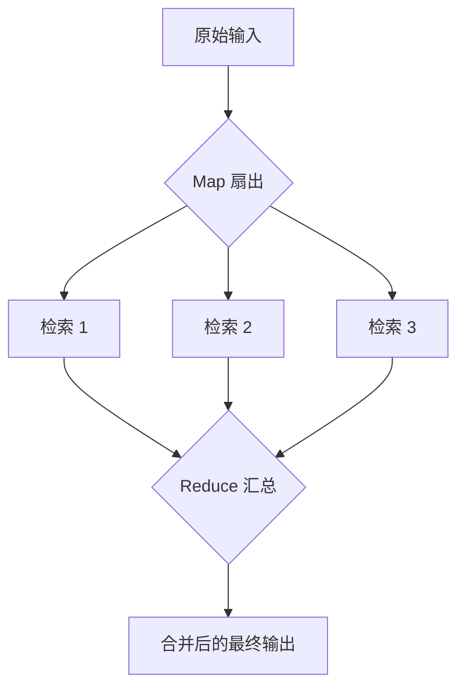

# MapReduce
MapReduce模式，常用于：

1. 拆分任务
2. 并发处理
3. 汇总结果

## 核心思想

对应LangGraph两个阶段：
1. Map阶段：将一份输入（列表）拆分成多份，并发的执行，扇出的阶段
2. Reduce阶段：将所有分支的结果做一个汇总，传入下一个节点，扇入的阶段


流程示意图如下：




# sendApi
在LangGraph中，**每次调用 `send()` 就相当于在图中派生出一条新的任务分支**，这类似于Map阶段的扇出器。

**基础语法**

```bash
new Send(targetNode, state)
- targetNode：要把任务派发给哪一个节点
- state：发送给该节点的状态数据
```

# 快速上手
```bash
import { StateGraph, START, END, Send } from "@langchain/langgraph";
import { registry } from "@langchain/langgraph/zod";
import { z } from "zod";
import { schemaMetaRegistry } from "@langchain/langgraph/zod";

const Schema = z.object({
  items: z.array(z.string()), # items: [a, b, c]
  results: z.array(z.string()).register(registry, {
    reducer: {
      fn: (prev: string[], next: string[]) => prev.concat(next),
    },
    default: () => [],
  }),
});

type TState = z.infer<typeof Schema>;

# map节点
const fanout = (state: TState) =>
  state.items.map((item) => new Send("worker", { item }));

# 负责将小写字母转成大写
const worker = (state: { item: string }) => ({
  results: [state.item.toUpperCase()],
});

# 构件图
const graph = new StateGraph(Schema)
  .addNode("worker", worker)
  .addConditionalEdges(START, fanout)
  .addEdge("worker", END)
  .compile();

const result = await graph.invoke({
  items: ["abc", "def", "ghi"],
});

console.log(result);
```

**可以换个形式重新定义的Schema**

```bash
import { schemaMetaRegistry } from "@langchain/langgraph/zod";

const resultSchema = z.array(z.string());
schemaMetaRegistry.extend(resultSchema, () => ({
  reducer: {
    schema: z.array(z.string()), # 定义类型
    fn: (prev: string[], next: string[]) => prev.concat(next),
  },
  default: () => [],
}));


const Schema = z.object({
  items: z.array(z.string()), # items: [a, b, c]
  results: resultSchema,
});
```

# 场景案例：

电商风控系统，对一批订单并发打风险分，再统一汇总高危订单与统计报表。
业务需求：

- 输入：一批待审核订单 `orders`
- Map 阶段：对每个订单并发调用“风控服务”（可以是 HTTP 服务，也可以是 LLM：`是否存在欺诈风险？`）
- Reduce 阶段：
  - 收集所有订单的风险评分
  - 计算统计信息（高危订单数量、比例等）
  - 输出一个“高危订单列表 + 简单统计报表”

对应到 LangGraph 的 MapReduce 模式：

1. `fanoutOrders(Map)`：对 orders 做 `Send("scoreOrder", { order })`
2. `scoreOrder(Worker)`：调用风控服务，返回 `{ orderId, riskScore, level }`
3. `aggregateRisk(Reduce)`：从 `riskResults[]` 中做汇总，生成最终输出

```bash
import { StateGraph, START, END, Send } from "@langchain/langgraph";
import { registry } from "@langchain/langgraph/zod";
import { z } from "zod";

# 单个订单的Schema
const OrderSchema = z.object({
  id: z.string().describe("订单的id"),
  userId: z.string().describe("用户id"),
  amount: z.number().describe("订单的金额"),
  ip: z.string().describe("下单的ip"),
  device: z.string().optional().describe("设备信息"),
});

type OrderType = z.infer<typeof OrderSchema>;

# 风险评估结果的Schema
const RiskResultsSchame = z.object({
  orderId: z.string().describe("订单的id"),
  riskScore: z.number().describe("风险分数"),
  level: z.enum(["low", "mid", "high"]).describe("风险等级"),
});

type RiskResultType = z.infer<typeof RiskResultsSchame>;

# 状态的Schema
const Schema = z.object({
  orders: z.array(OrderSchema),
  riskResults: z.array(RiskResultsSchame).register(registry, {
    reducer: {
      fn: (prev: string[], next: string[]) => prev.concat(next),
    },
    default: () => [],
  }),
  summary: z.object({
    total: z.number().describe("订单总数"),
    highRiskCount: z.number().describe("高风险订单数量"),
    highRiskRate: z.number().describe("订单评分"),
  }),
});

type StateType = z.infer<typeof Schema>;
type riskLevltype = "low" | "mid" | "high";

const fanoutOrders = (state: StateType) =>
  state.orders.map((order) => new Send("scoreOrder", order));

# 模拟外部风控系统，返回风控评估结果
const callRiskService = (order: OrderType): RiskResultType => {
  # 做一些风控模拟
  const base = order.amount / 100; # 金额越多风险越高，算个基础分
  const random = Math.random() * 10; # 随机因素影响打分
  const score = Math.min(100, base * 10 + random); # 计算最终分，分数的范围0-100
  let level: riskLevltype = "low";
  if (score >= 70) level = "high";
  else if (score >= 40) level = "mid";

  return {
    orderId: order.id,
    riskScore: score,
    level,
  };
};

# 针对单个订单做打分操作
const scoreOrder = async (state: OrderType) => {
  const risk = await callRiskService(state);
  return {
    riskResults: [risk],
  };
};

# 汇总节点：对所有订单结果进行汇总操作
const aggregateRisk = (state: StateType) => {
  const total = state.orders.length; # 订单总量
  # 找出高风险订单
  const highRisk = state.riskResults.filter((r) => r.level === "high");
  return {
    summary: {
      total,
      highRiskCount: highRisk.length,
      highRiskRate: total === 0 ? 0 : highRisk.length / total,
    },
  };
};

const graph = new StateGraph(Schema)
  .addNode("scoreOrder", scoreOrder)
  .addNode("aggregateRisk", aggregateRisk)
  .addConditionalEdges(START, fanoutOrders)
  .addEdge("scoreOrder", "aggregateRisk")
  .addEdge("aggregateRisk", END)
  .compile();

# 测试用例
const input = {
  orders: [
    { id: "o1", userId: "u1", amount: 99, ip: "1.1.1.1" },
    { id: "o2", userId: "u2", amount: 560, ip: "2.2.2.2" },
    { id: "o3", userId: "u3", amount: 3000, ip: "3.3.3.3" },
  ],
  riskResults: [],
};

const result = await graph.invoke(input);
console.log(result);
```