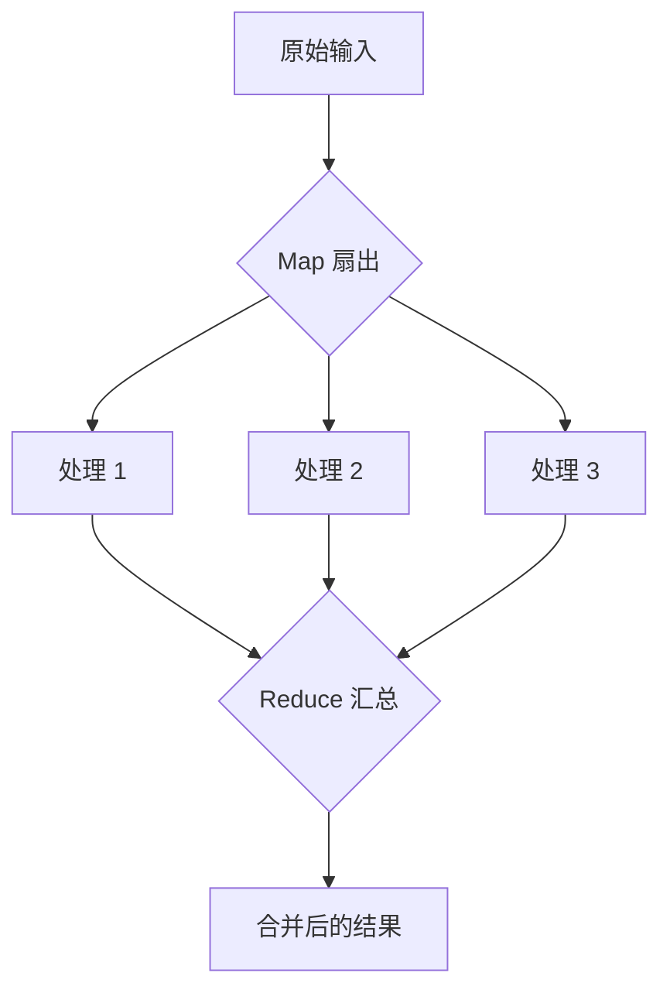

# 🗺️ MapReduce

把一份列表拆开，每条单独处理，再汇成一个结果。

1. Map：扇出。列表里的每一项并发跑同一个节点
2. Reduce：扇入。等分支都写完，下一个节点做汇总



# Send

每调用一次 `Send`，就从当前这步拉出一条新分支。

```js
new Send(targetNode, state);
// targetNode：派给哪个节点
// state：这条分支拿到的状态，不必是整张图的状态
```

`items` 有三项，就发出三个 `Send("worker", { item })`。worker 只看到自己的 `item`，把结果放进 `results`。`results` 用 reducer 拼接，三个分支的数组合并成一个。

```js
import { StateGraph, START, END, Send } from "@langchain/langgraph";
import { registry } from "@langchain/langgraph/zod";
import { z } from "zod";

const Schema = z.object({
  items: z.array(z.string()),
  results: z.array(z.string()).register(registry, {
    reducer: {
      fn: (prev, next) => prev.concat(next),
    },
    default: () => [],
  }),
});

const fanout = (state) => state.items.map((item) => new Send("worker", { item }));

const worker = (state) => ({
  results: [state.item.toUpperCase()],
});

const graph = new StateGraph(Schema)
  .addNode("worker", worker)
  .addConditionalEdges(START, fanout)
  .addEdge("worker", END)
  .compile();

const result = await graph.invoke({
  items: ["abc", "def", "ghi"],
});
```

reducer 也可以先登记在数组 schema 上，再放进状态：

```js
import { schemaMetaRegistry } from "@langchain/langgraph/zod";

const resultSchema = z.array(z.string());
schemaMetaRegistry.extend(resultSchema, () => ({
  reducer: {
    schema: z.array(z.string()),
    fn: (prev, next) => prev.concat(next),
  },
  default: () => [],
}));

const Schema = z.object({
  items: z.array(z.string()),
  results: resultSchema,
});
```

# 风控打分

一批订单并发打风险分，再汇总高危数量和比例。

1. `fanoutOrders`：每个订单一个 `Send("scoreOrder", order)`。worker 收到的 state 就是这一张订单
2. `scoreOrder`：算出 `{ orderId, riskScore, level }`，放进 `riskResults`
3. `aggregateRisk`：等全部分数到齐，写 `summary`

```js
import { StateGraph, START, END, Send } from "@langchain/langgraph";
import { registry } from "@langchain/langgraph/zod";
import { z } from "zod";

const OrderSchema = z.object({
  id: z.string().describe("订单 id"),
  userId: z.string().describe("用户 id"),
  amount: z.number().describe("金额"),
  ip: z.string().describe("下单 IP"),
  device: z.string().optional().describe("设备"),
});

const RiskResultSchema = z.object({
  orderId: z.string(),
  riskScore: z.number(),
  level: z.enum(["low", "mid", "high"]),
});

const Schema = z.object({
  orders: z.array(OrderSchema),
  riskResults: z.array(RiskResultSchema).register(registry, {
    reducer: {
      fn: (prev, next) => prev.concat(next),
    },
    default: () => [],
  }),
  summary: z
    .object({
      total: z.number(),
      highRiskCount: z.number(),
      highRiskRate: z.number(),
    })
    .optional(),
});

const fanoutOrders = (state) => state.orders.map((order) => new Send("scoreOrder", order));

const callRiskService = (order) => {
  const base = order.amount / 100;
  const random = Math.random() * 10;
  const score = Math.min(100, base * 10 + random);
  let level = "low";
  if (score >= 70) level = "high";
  else if (score >= 40) level = "mid";
  return { orderId: order.id, riskScore: score, level };
};

const scoreOrder = async (order) => ({
  riskResults: [callRiskService(order)],
});

const aggregateRisk = (state) => {
  const total = state.orders.length;
  const highRisk = state.riskResults.filter((item) => item.level === "high");
  return {
    summary: {
      total,
      highRiskCount: highRisk.length,
      highRiskRate: total === 0 ? 0 : highRisk.length / total,
    },
  };
};

const graph = new StateGraph(Schema)
  .addNode("scoreOrder", scoreOrder)
  .addNode("aggregateRisk", aggregateRisk)
  .addConditionalEdges(START, fanoutOrders)
  .addEdge("scoreOrder", "aggregateRisk")
  .addEdge("aggregateRisk", END)
  .compile();

const result = await graph.invoke({
  orders: [
    { id: "o1", userId: "u1", amount: 99, ip: "1.1.1.1" },
    { id: "o2", userId: "u2", amount: 560, ip: "2.2.2.2" },
    { id: "o3", userId: "u3", amount: 3000, ip: "3.3.3.3" },
  ],
  riskResults: [],
});
```
